# body-telemetry

**See what your agents do.** body-telemetry is a small server and a dashboard for the AI characters you run with
[body-harness](https://github.com/newsbubbles/body-harness) in [embody](https://github.com/newsbubbles/embody) worlds:
what they spend, how big their context gets, which tools
they reach for and in what order, how often the world says no, which of the harness's helpers they lean on, the
behavior graphs they write for themselves, and how your eval runs score. Every number can be sliced by world, seat,
character, model, settings, harness version or eval run, for one agent, a group of them or all of them, on your
desktop or your phone.

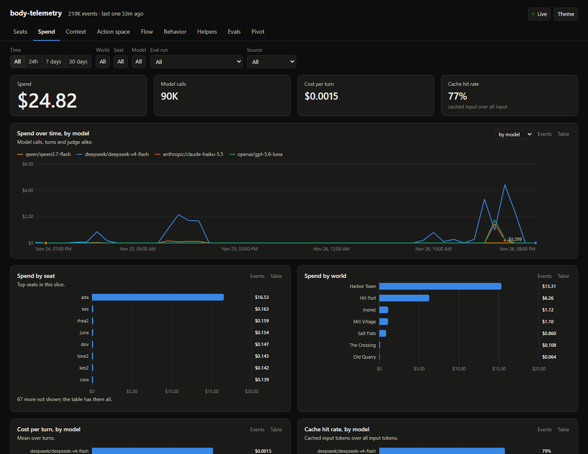

## It is yours

body-telemetry is not a service, and it does not watch your agents for anyone else.

- **You run it.** On your laptop, on a box behind your VPN, or on a host you rent. There is no body-telemetry
  company, account or cloud. Nothing is sent anywhere except the server you start.
- **It is off until you turn it on.** body-harness sends nothing unless a seat's config names your server.
- **Counts, not conversations.** By default a seat sends numbers and names only: tokens, cost, which tool, ok or
  refused. No speech, no notes, no player words. You can choose to send more (see [What is sent](#what-is-sent)).
- **One file.** Everything lives in one SQLite file. Copy it, back it up, or delete it, and it is gone.
- **No dependencies.** The server is the Python standard library (`http.server` and `sqlite3`). The dashboard is one
  HTML page with hand-drawn SVG charts. Nothing is loaded from the internet.

## Start in two minutes

You need Python 3.11 or newer.

```bash
pip install git+https://github.com/newsbubbles/body-telemetry
```

```bash
body-telemetry serve
```

Open <http://127.0.0.1:8899/>. The server listens on this machine only, until you choose otherwise.

### Load what your seats already wrote

body-harness keeps every seat's history in files. Import them, and the dashboard fills in with everything from before
you turned telemetry on:

```bash
body-telemetry import ~/.body-harness
```

You can point it at a home, one seat folder, or an eval output folder (it finds every `results.jsonl` below it).
Importing the same folder twice adds nothing new, and for a seat that already sends live events the import adds only
what came before the first one. The importer reads only the count files (`usage.jsonl`,
`ledger.jsonl`, `calls.jsonl`, `reflexes.jsonl`, `invented.jsonl`, `outbox.jsonl` and eval `results.jsonl`), each
seat's `config.json`, the world and character names from `state.json`, and a behavior eval's transcripts for the
graphs the agents wrote. From the config it keeps only switches, numbers and model names (so the seat page can show
how each agent is set up), never prompts, providers, env files or anything named like a key. It never opens door
files, invites or keys. Like the sender, it keeps counts only unless you pass `--detail lines` or `--detail full`.

If you import several homes from one machine and their seats share names, give each home its own label so they stay
apart: `body-telemetry import ~/home-a --machine a`.

### Send live events from your seats

Add this to a seat's `config.json`, or to the home `config.json` for every seat:

```json
"telemetry": {"url": "http://127.0.0.1:8899", "detail": "counts"}
```

Each seat writes its events to a local spool file first and posts them in batches every 20 seconds. If the server is
down, the seat keeps playing and the spool waits. The dashboard updates by itself while the **Live** light is on.

## What is sent

You choose the detail level per seat or per home. `counts` is the default.

| detail | what leaves the seat |
|---|---|
| `counts` | Numbers (tokens, cost, wait times, steps, deeds), the names of tools, verbs, models, the world and the character, whether a call was refused and the world's refusal code, the kind of each harness nudge (`stuck`, `quiet`), what woke a turn (a timeout, an event, being spoken to) and whether another seat did, and the shape of a behavior graph (node kinds, edges, the op and verb of each deed). **No speech, notes, wake reasons, nudge text or the words inside a graph.** |
| `lines` | Also the wake reason, the turn's note, a refusal's reason, a nudge's text and a graph's conditions and questions, each cut to 120 characters. |
| `full` | The same, uncut. Players' words are other people's words: use this only for a world you own. |

Never sent at any level: tokens or keys, door files, invites, the character's brief, the model's messages, or tool
arguments (other than the verb of an act).

A server can also cut what arrives, whatever the seats send: `body-telemetry serve --max-detail counts`.

## The dashboard

| view | what it answers |
|---|---|
| **Seats** | Every character: model, turns, spend (all and the last 24 hours), last wake, refusals, and whether it is awake, quiet, asleep, stopped or in error. |
| **Spend** | Spend over time by model, seat and world; cost per turn; cache hit rate. |
| **Context** | Input per call over time (median and the top 5%), by model and by seat; how big tool answers are; what the context is made of (system prompt, tools, wake, history, tool results), by model and over time. |
| **Action space** | Tool mix by model and by settings, the verbs agents act with, refusal rates by tool and by the world's reason, invented tool names. |
| **Flow** | What agents call next, like a site's user flow: from the start of a turn, or from every call of one op or a set of ops, the next calls step by step, with refusals marked. Click an op to start from it; compare models, settings, worlds or seats side by side. |
| **Helpers** | The things the harness adds to help smaller models (escalation, imagination, the past, the menu, the think tool, reflexes, sleep and nudges): which seats have each on, how often each is used per 100 turns, by model and by seat, which nudges fire and which models turns escalate to. |
| **Seat** | Click any seat for its own page: how it is set up, which helpers it has on and uses, the behavior graphs it wrote, what it does in a turn, and its spend. | Turns over time; deeds, lines said and reads per turn; turns with no deed; nudges; turns that ran out of steps. |
| **Evals** | Pass rate per case and variant with 95% intervals, by variant, model, scene and settings, cost per sample, and for a behavior eval the graph each agent wrote, drawn, with its score. |
| **Pivot** | Any measure, grouped by any label, split by another, over time or not. |

Everything on the page can be explored:

- **Click any bar, segment, legend entry or table cell** to filter every chart to it. Filters show as chips; click
  the x to remove one.
- **Pick a group.** World, seat and model take several values: tick a set of seats (search helps) and every view is
  about that group. Flow can compare the members of a group side by side.
- **Drag across any time chart** to zoom every view to that stretch of time. Double-click to go back.
- **Events** on any chart opens the rows behind it, newest first. Click a row to see all its fields.
- **Table** on any chart shows its numbers as a table.
- **Split** on a time chart shows the same measure by model, seat, world, settings or run.
- **Links keep the view.** The address holds the view and its filters, so you can send someone the exact slice.

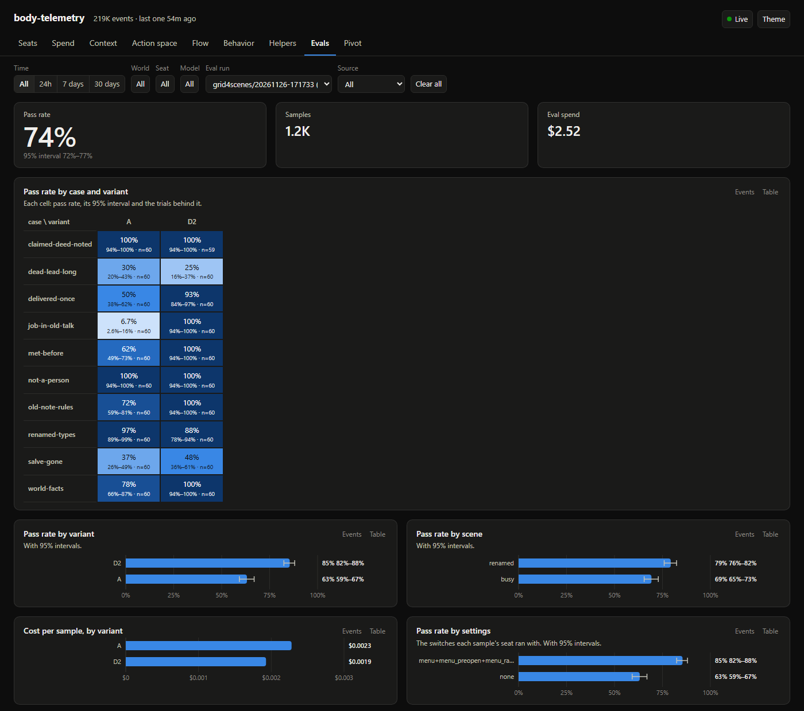

It works on a phone: seats become cards, filters fold away, and every chart fits the screen.

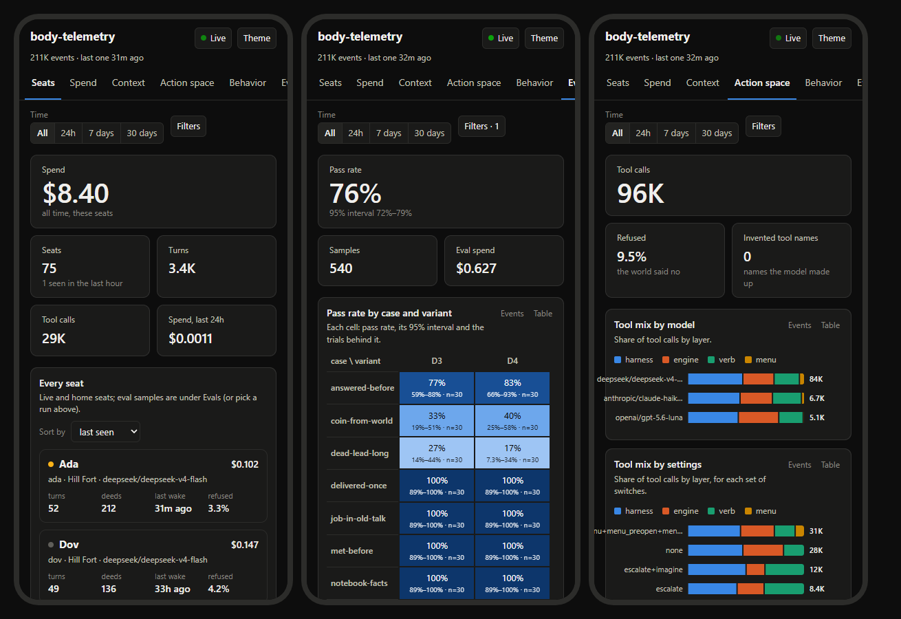

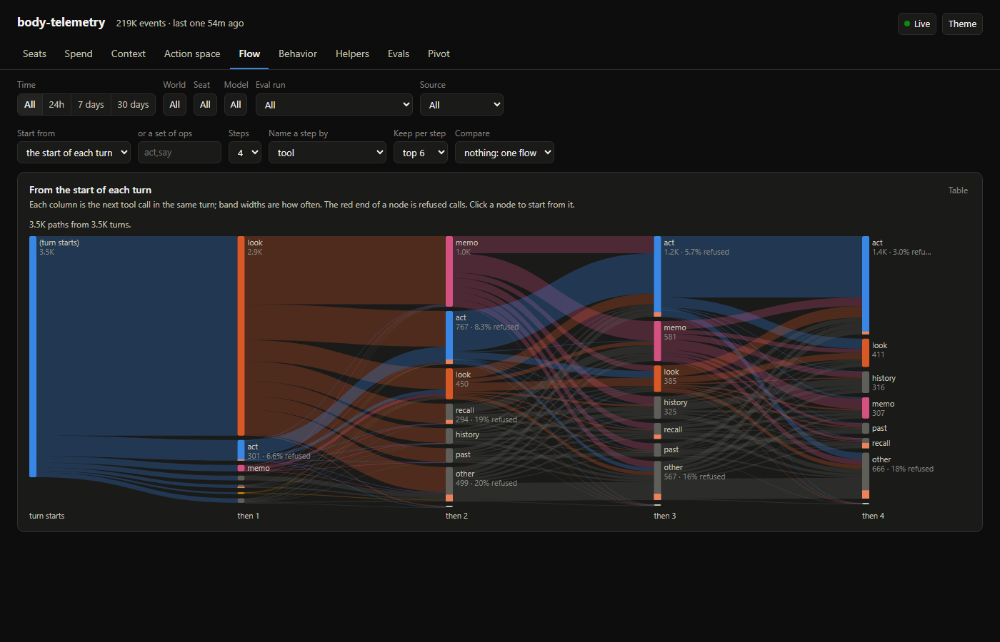

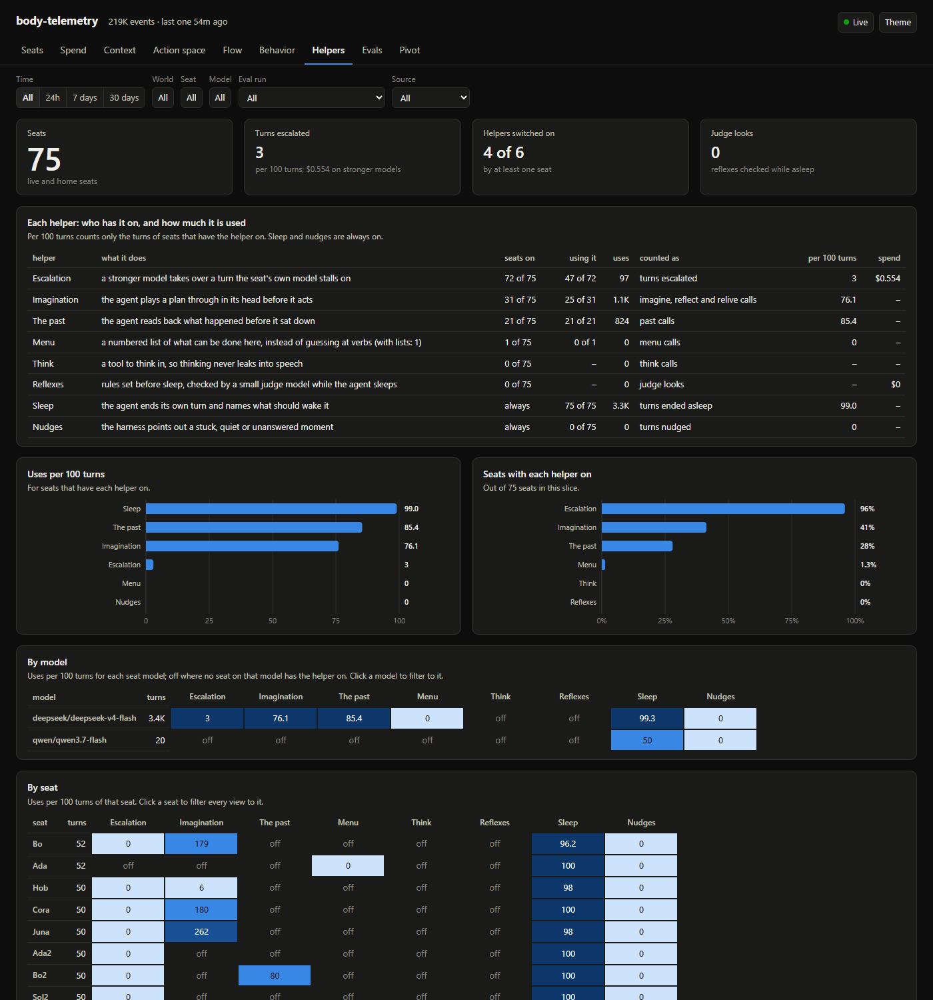

<details>
<summary>More views</summary>

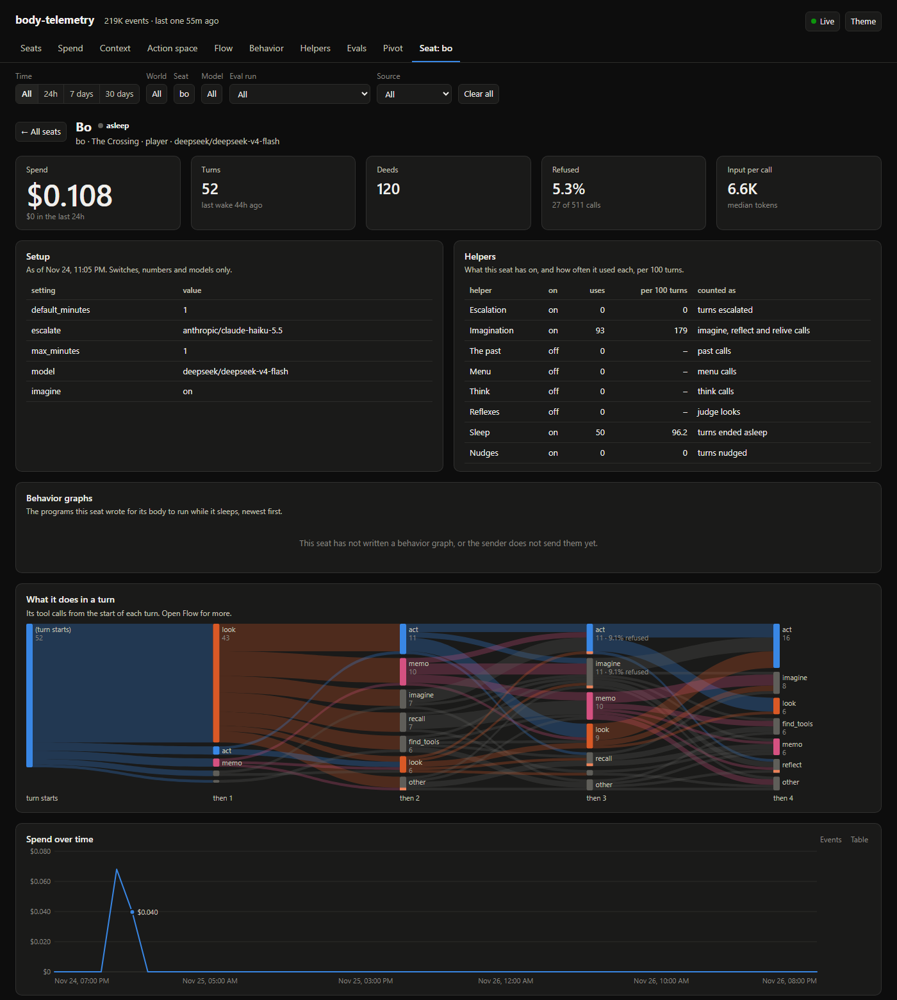
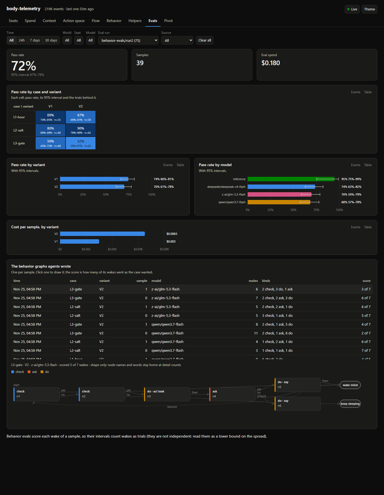
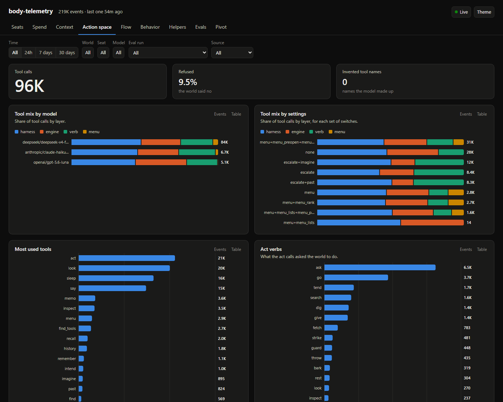
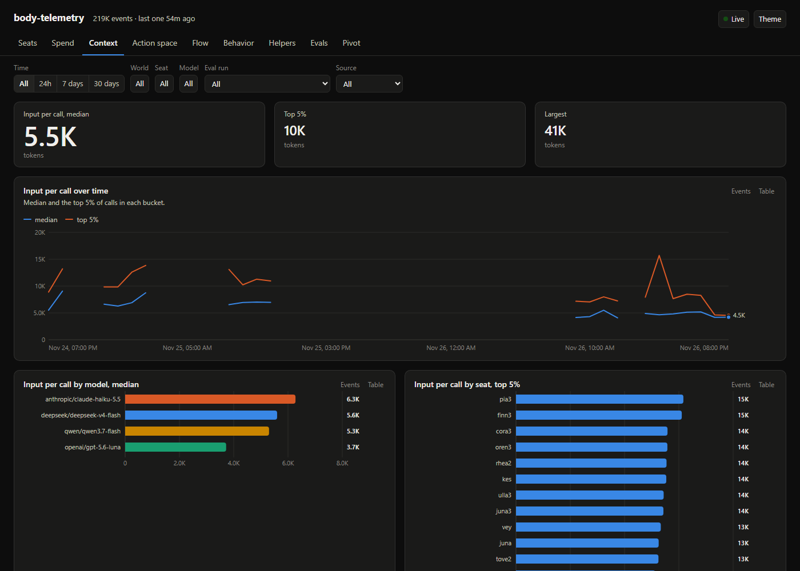
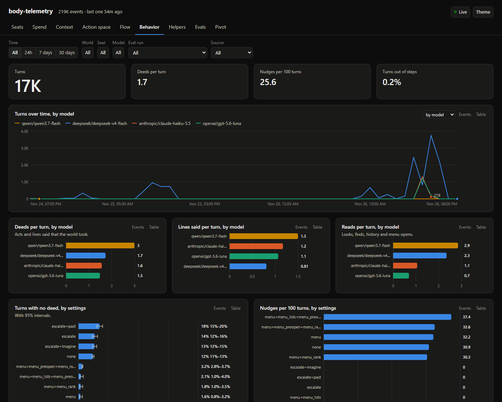
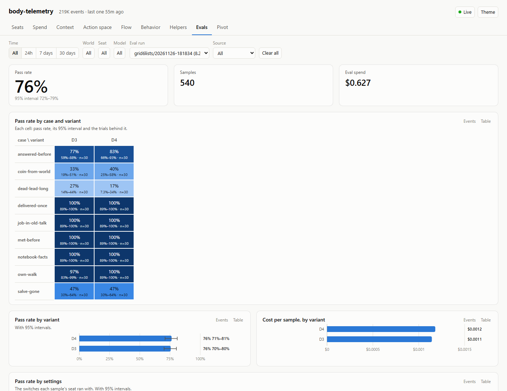

</details>

## Hosting

| where | how |
|---|---|
| This machine | `body-telemetry serve`. It listens on `127.0.0.1` and needs no key. |
| Behind your VPN | Set a key and listen on the VPN address: `BODY_TELEMETRY_KEY=... body-telemetry serve --host 10.0.0.5`. |
| A host you rent | Set `BODY_TELEMETRY_KEY`, listen on `0.0.0.0`, and keep the database on a disk that survives restarts (`--db /data/telemetry.db`). `PORT` is read from the environment. |

The server refuses to listen beyond this machine without a key. With a key, posting and reading both need
`Authorization: Bearer <key>`. The dashboard asks for the key once and keeps it in your browser. Seats read the key
from an environment variable (`BODY_TELEMETRY_KEY` by default, or the name in the seat's `key_env`).
`--open-read` lets anyone who can reach the server read the dashboard, while posting still needs the key.

## How it stores things

One table, one row per event, with the same labels on every row: time, world, seat, character, role, model, provider,
harness version, a hash of the seat's settings and its main switches, machine label, and eval run. The kinds of event
are `model_call`, `tool_call`, `turn`, `seat`, `setup`, `behavior`, `invented`, `reflex`, `tell` and `eval_sample`. Fields the store does
not know yet go into a JSON column, so a newer harness never breaks an older server, and you can still group by them
(as `x.<field>`).

## The API

| call | what |
|---|---|
| `POST /v1/events` | `{"events": [...]}`, up to 5,000 a batch. An event the server already holds is not added twice. |
| `GET /v1/query` | `measure`, `by` (labels, comma separated), `bucket` (`hour`, `day`, or seconds), `since`, `until` (Unix seconds, `24h`, `7d` or a date), and any label as a filter (`seat=ada,bo`, `not.code=(none)`). |
| `GET /v1/events` | The rows behind a slice, newest first, with the same filters. |
| `GET /v1/flow` | What comes next: `start` (an op, a set like `act,say`, or empty for the start of a turn), `depth`, `node` (`tool` or `verb`), `top`, and the same filters. Steps and links with counts and shares. |
| `GET /v1/helpers` | Each helper: seats with it on, uses, uses per 100 turns, spend; the same by model and by seat; nudge kinds; escalation targets. |
| `GET /v1/seats` | One row per seat, with its state (awake, quiet, asleep, stopped, errors). |
| `GET /v1/seat` | One seat close up: `seat=`, its summary, setup, helpers and latest behavior graphs. |
| `GET /v1/graphs` | Behavior graphs agents wrote, newest first, with what each scored. |
| `GET /v1/meta` | What the store holds: kinds, time range, measures, labels and their values. |

Measures include `spend`, `input_p50`, `input_p95`, `cache_hit`, `cost_per_turn`, `deeds_per_turn`, `refusal_rate`,
`out_of_steps`, `nudges_per_100`, `pass_rate` and more (the full list is in `/v1/meta`), or any aggregate of a number
column such as `p95:secs` or `avg:deeds`. Shares of trials (pass rate, refusal rate) come with a 95% Wilson interval.

The server does all the counting: the dashboard only asks these calls and draws what comes back, so anything you see
on the page, a script or an agent can read too.

The same queries work from the command line:

```bash
body-telemetry query measure=pass_rate by=variant run=grid/20261126-120000
```

## The family

- [embody](https://github.com/newsbubbles/embody): the world engine. Worlds, their rules and their history live there.
- [body-harness](https://github.com/newsbubbles/body-harness): a mind for one body in an embody world. Its seats send
  their counts here when their config names this server
  ([the wire format](https://github.com/newsbubbles/body-harness/blob/main/docs/telemetry.md)).
- body-telemetry (this repo): a server and dashboard you run yourself, for what every seat spends and does, sliced
  any way.

## Develop

```bash
python -m unittest discover -s tests
```

No dependencies to install. The dashboard is `src/body_telemetry/dashboard.html`: edit it and reload the page.

## License

MIT
